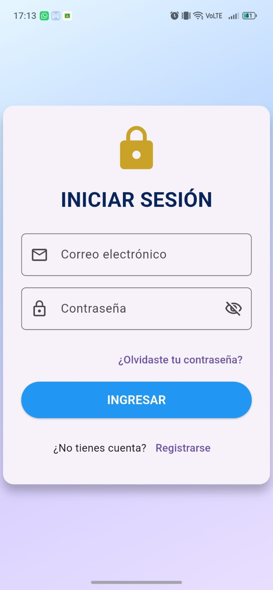
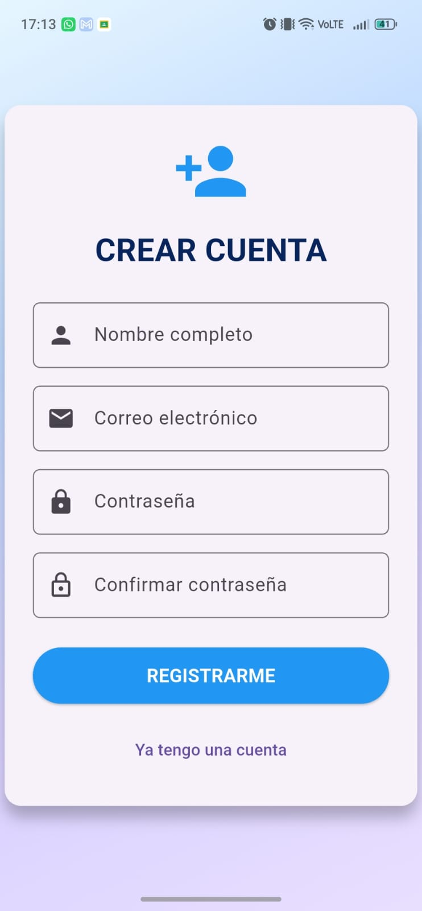
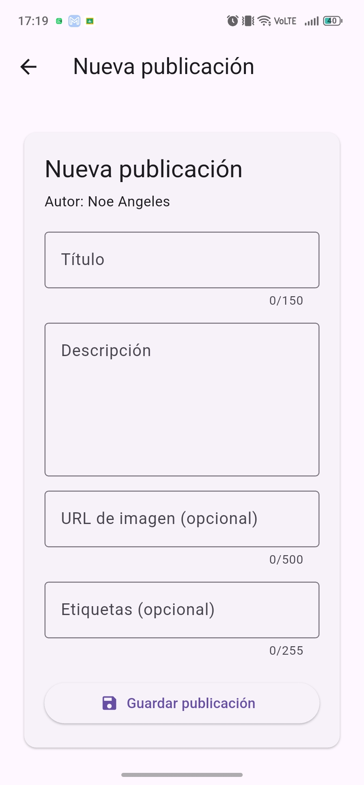
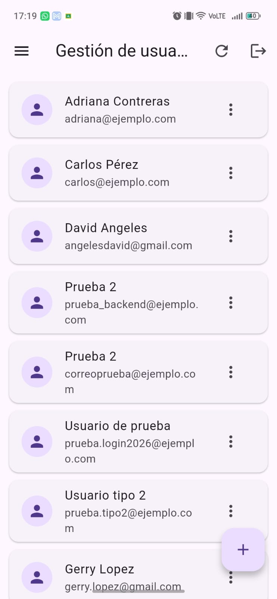

# 📝 Blog móvil — Flutter + FastAPI + MySQL

Aplicación móvil de blog donde los usuarios se registran, inician sesión, publican entradas, leen las publicaciones propias y de otros usuarios y comentan en ellas.  
Proyecto final — **Evaluación Unidad 3: Caso práctico "Diseño de blog"**.

| Capa | Tecnología |
|---|---|
| App móvil | Flutter (Dart) · Android |
| API REST | FastAPI (Python) · SQLAlchemy · Pydantic |
| Base de datos | MySQL / MariaDB |
| Seguridad | Contraseñas con **Argon2id** · sesiones con **JWT** · token guardado en **Android Keystore** |

**Autor(es):** _[ Noé David Angeles López / Angelo Uriel Rivera Gascon ]_ · **Materia:** _[ Programación para Nóviles ]_ · **Docente:** _[ Adriana Y. Contreras Alvarez ]_

---

## 📸 Capturas

| Inicio de sesión | Registro | Lista de posts |
|---|---|---|
|  |  |  |

| Detalle + comentarios | Nueva publicación | Gestión de usuarios (admin) |
|---|---|---|
|  |  |  |

---

## ✅ Funcionalidades

- Registro e inicio de sesión desde el dispositivo móvil con validación de credenciales.
- Contraseñas cifradas con Argon2id (nunca se guardan en texto plano).
- Sesión con **JWT** (expira en 60 min) guardado en almacenamiento cifrado; la sesión se restaura al reabrir la app y se destruye al cerrar sesión.
- Dos roles: **administrador** (`tip_usu = 1`) y **usuario general** (`tip_usu = 2`).
- Publicar entradas; ver entradas propias (filtro **Mis posts**) y de otros usuarios; búsqueda y filtro por etiqueta.
- Crear y leer comentarios en cada publicación.
- Administrador: alta, edición y baja de usuarios.
- Perfil: edición de nombre, correo y dirección.

## 🗂️ Estructura del repositorio

```
.
├── backend_api/                 # API FastAPI
│   ├── main.py                  #   endpoints
│   ├── security.py              #   Argon2 + JWT + control de acceso
│   ├── models.py                #   modelos ORM (SQLAlchemy)
│   ├── schemas.py               #   validación (Pydantic)
│   ├── database.py              #   conexión a MySQL
│   ├── requirements.txt
│   └── .env.example             #   plantilla de variables (copiar a .env)
├── database/
│   ├── bd_aplicacion_movil.sql  # script de creación de la BD
├── flutter_application_1/       # App móvil Flutter
│   └── lib/{config,models,screens,services,widgets}
├── docs/                        # reporte, diagramas y capturas
└── README.md
```

---

## 🔧 Requisitos previos

- Python 3.10+ · MySQL 8 o MariaDB (por ejemplo XAMPP/MySQL Workbench)
- Flutter SDK (3.x) y Android Studio con un emulador **o** un celular Android con depuración USB
- Celular/emulador y computadora en la **misma red Wi-Fi** (solo para celular físico)

## 🚀 Instalación y ejecución

### 1) Base de datos

```bash
mysql -u root -p < database/bd_aplicacion_movil.sql
```
(o abre el archivo en MySQL Workbench / phpMyAdmin y ejecútalo). Crea la base `bd_aplicacion_movil` con las tablas `usuario`, `blog` y `comentarios`.

### 2) API (FastAPI)

```bash
cd backend_api
python -m venv venv
# Windows:  venv\Scripts\activate        Linux/Mac:  source venv/bin/activate
pip install -r requirements.txt
cp .env.example .env        # Windows: copy .env.example .env
```

Edita `.env` con tu contraseña de MySQL y genera una clave secreta:

```bash
python -c "import secrets; print(secrets.token_hex(32))"   # pega el resultado en SECRET_KEY
```

Inicia el servidor (`--host 0.0.0.0` permite que el celular lo alcance):

```bash
uvicorn main:app --host 0.0.0.0 --port 8000 --reload
```

Documentación interactiva: <http://127.0.0.1:8000/docs>

### 3) Crear el primer administrador

1. Regístrate desde la app (se crea como usuario general).
2. Conviértete en admin en MySQL:
   ```sql
   UPDATE usuario SET tip_usu = 1 WHERE mail = 'tu_correo@ejemplo.com';
   ```
3. Cierra sesión y vuelve a entrar.

### 4) App Flutter

```bash
cd flutter_application_1
flutter pub get
```

La dirección de la API se pasa con `--dart-define=API_URL=...`:

| Dónde corre la app | Valor de `API_URL` |
|---|---|
| Emulador de Android Studio | `http://10.0.2.2:8000` (valor por defecto, no hace falta indicarlo) |
| Celular físico | `http://IP_DE_TU_PC:8000` (ej. `http://192.168.1.50:8000`; consúltala con `ipconfig` / `ifconfig`) |

```bash
# Emulador
flutter run

# Celular físico conectado por USB
flutter run --dart-define=API_URL=http://192.168.1.50:8000
```

**En Android Studio:** abre la carpeta `flutter_application_1` → *Run ▸ Edit Configurations* → en **Additional run args** escribe `--dart-define=API_URL=http://192.168.1.50:8000` → ▶ Run.

### 5) Generar el APK

```bash
cd flutter_application_1
flutter build apk --release --dart-define=API_URL=http://192.168.1.50:8000
```
Resultado: `build/app/outputs/flutter-apk/app-release.apk` → cópialo al celular e instálalo (permite "instalar apps de orígenes desconocidos").  
La IP queda **incrustada** en el APK: si cambia la IP de tu PC, vuelve a generarlo.

---

## 🔐 Seguridad implementada

| Mecanismo | Implementación |
|---|---|
| Cifrado de contraseñas | Argon2id con sal aleatoria (`pwdlib`); en la BD solo se guarda el hash |
| Sesiones | JWT firmado HS256 con `SECRET_KEY` (en `.env`, fuera del repositorio), expira en 60 min |
| Almacenamiento en el móvil | `flutter_secure_storage` (Android Keystore) |
| Control de acceso | Todas las rutas (salvo `/login` y el registro) exigen `Authorization: Bearer <token>`; las rutas de administración devuelven **403** a usuarios generales |
| Sin escalada de privilegios | El registro público siempre crea `tip_usu = 2`; solo un admin autenticado crea admins |
| Autoría confiable | El autor de posts y comentarios se toma del **token**, nunca del cuerpo de la petición |
| Validación | Pydantic (longitudes, tipos); validaciones también en la app |
| Manejo de errores | 401 (credenciales/sesión), 403 (permisos), 404, 409 (correo duplicado), 422 (datos inválidos); mensaje genérico en login para no revelar si el correo existe |

## 🌐 Endpoints principales

| Método | Ruta | Acceso |
|---|---|---|
| POST | `/login` | Público → devuelve usuario + `access_token` |
| POST | `/usuarios` | Público (rol general) / Admin (cualquier rol) |
| GET | `/usuarios` | Admin |
| PUT | `/usuarios/{id}` | Dueño de la cuenta o Admin |
| DELETE | `/usuarios/{id}` | Admin |
| GET / POST | `/blog` | Usuario autenticado |
| GET | `/blog/{id}` | Usuario autenticado |
| GET / POST | `/comentarios` (`?blog_id=`) | Usuario autenticado |

---

## 🧰 Solución de problemas

| Síntoma | Causa / solución |
|---|---|
| "No se pudo conectar con la API" en el celular | PC y celular en distinta red, `API_URL` con IP incorrecta, API iniciada sin `--host 0.0.0.0`, o el **firewall de Windows** bloquea el puerto 8000 (permite Python / abre el puerto) |
| Funciona en debug pero no en el APK | Falta el permiso `INTERNET` (ya incluido en `AndroidManifest.xml`) |
| `RuntimeError: Define SECRET_KEY` | No existe `.env` o `SECRET_KEY` mide menos de 32 caracteres |
| "Sesión expirada" | El token dura 60 min: vuelve a iniciar sesión |

## ⚠️ Notas

- El tráfico es HTTP (red local de desarrollo). En producción debe usarse **HTTPS** y retirar `usesCleartextTraffic` del manifiesto.
- La pantalla "Recuperar contraseña" es solo interfaz (no envía correos).
- El archivo `.env` **no** se sube al repositorio; usa `.env.example` como plantilla.

## 📄 Reporte técnico

El reporte digital (diagramas, seguridad, evidencias y reflexión) está en [`docs/`](docs/).
